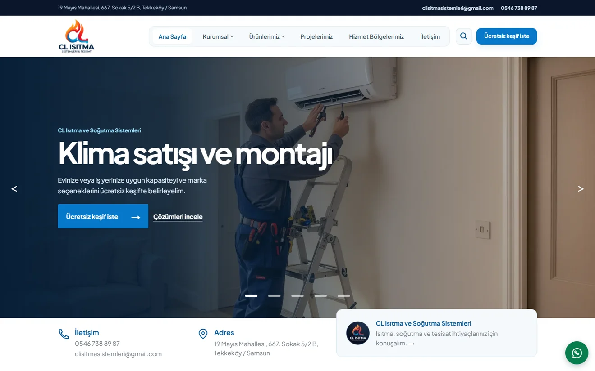

<p align="center">
  
</p>

# CL Isıtma Sistemleri

Samsun ve Tekkeköy’de klima, kombi, ısı pompası ve tesisat hizmetleri sunan CL Isıtma’nın kurumsal web sitesi. Ziyaretçiler ürünleri inceleyebilir, marka veya model arayabilir, saha projelerini görebilir ve ücretsiz keşif talebi iletebilir.



## Özellikler

- Marka, model ve ürün türüne göre arama ve ürün kataloğuna doğrudan bağlantılar
- Saha fotoğraflarından oluşan proje galerisi ve çalışılan markaların gösterimi
- Mobilde uyumlu menü, keşif formu ve WhatsApp iletişim bağlantısı
- Samsun ve Tekkeköy odaklı sayfa açıklamaları, yapılandırılmış işletme verisi ve site haritası

## Yerelde çalıştırma

Proje Next.js App Router, React ve CSS ile geliştirilmiştir. Node.js 22.9 veya üzeri ve npm ile çalıştırabilirsiniz.

```bash
npm ci
npm run dev
```

Site [localhost:3000](http://localhost:3000) adresinde açılır. Katalog, ürün araması ve ana sayfadaki ürün kartları MySQL’deki yayında olan ürünleri gösterir.

## Ürün kataloğu ve yönetim paneli

MySQL ortam değişkenlerini ayarladıktan sonra katalog tablolarını ve yerel yönetici hesabını bir kez oluşturun.

```bash
npm run catalog:init
npm run admin:setup
```

Panel [localhost:3000/admin](http://localhost:3000/admin) adresindedir. Yerel giriş bilgileri Git dışında tutulan `.env.admin-credentials` dosyasına yazılır. Parolayı parola yöneticinize kaydettikten sonra bu dosyayı kaldırabilirsiniz. Sunucu ortamına `ADMIN_USERNAME`, `ADMIN_PASSWORD_HASH` ve `ADMIN_SESSION_SECRET` değerlerini girin. Canlı panel HTTPS üzerinden kullanılır.

Önce kategori ekleyin, ardından ürünü oluşturun. Ürün adresi marka, ad ve modelden otomatik üretilir. Teknik özellik alanı serbest metin ve `Özellik: Değer` satırlarını kabul eder. Ürün görsellerini tek alandan ekleyebilir, sıralayabilir veya üründen kaldırabilirsiniz. İlk görsel ürün kartında kapak olarak kullanılır. Görseli olmayan ürünlerde CL Isıtma görseli gösterilir.

Markalar sekmesi ana sayfadaki marka şeridini yönetir ve ürün formuna marka önerileri sağlar. Var olan logolar ve yeni yüklemeler Cloudinary üzerinden sunulur. Ürün yayına alındığında katalogda, navbar aramasında ve sitemap’te görünür. Ürün detayındaki WhatsApp bağlantısı model koduyla birlikte bilgi talebi oluşturur.

## Kontroller

```bash
npm run lint
npm run build
```

## Sunucu ayarları

E-posta gönderimi için `RESEND_API_KEY`, `RESEND_FROM_EMAIL` ve `RESEND_TO_EMAIL` değişkenlerini sunucu ortamında tanımlayın. MySQL bağlantı kontrolü için `MYSQL_HOST`, `MYSQL_PORT`, `MYSQL_DATABASE`, `MYSQL_USER` ve `MYSQL_PASSWORD` ayarlarını kullanın. Sağlayıcının TLS yapılandırmasına göre `MYSQL_SSL_MODE` veya `MYSQL_SSL_CA_FILE` da tanımlanabilir. Bağlantıyı `npm run db:check` ile kontrol edebilirsiniz.

Yerel değerleri Git dışında tutulan `.env.local` dosyasına, canlı ortam değerlerini barındırma servisinin ortam değişkenlerine girin.

## Görsel dağıtımı

`NEXT_PUBLIC_CLOUDINARY_CLOUD_NAME` görsel teslimatı için derleme ortamında tanımlanır. Panel ve toplu yükleme komutu için sunucu ortamında ayrıca `CLOUDINARY_API_KEY` ve `CLOUDINARY_API_SECRET` gerekir.

```bash
npm run media:sync
npm run build
```

Senkronizasyon, `public` içindeki görselleri ve katalogdaki üretici görsellerini yükler. Başarılı yüklemelerin kimlikleri `app/lib/cloudinary-assets.json` dosyasına yazılır. Değişmeyen görseller tekrar yüklenmez. Cloudinary, tarayıcıya uygun formatı ve ekran genişliğine uygun boyutu teslimat sırasında seçer. Katalog, marka şeridi ve galeri görselleri ekrana yaklaştıkça yüklenir.
